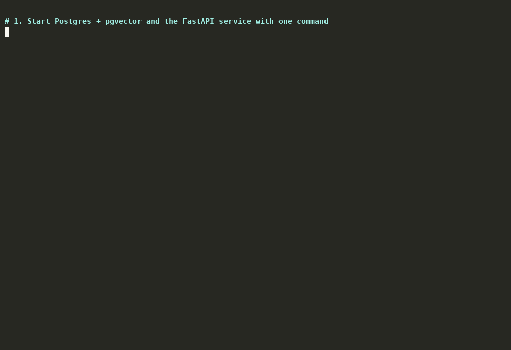
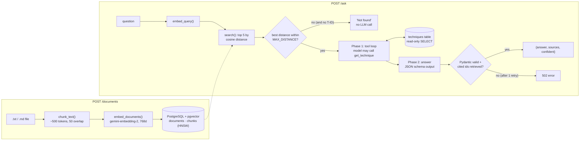

# Security RAG API

A small, hand-written Retrieval-Augmented Generation (RAG) service for security
content. Upload MITRE ATT&CK technique notes and incident response playbooks,
then ask questions. The model answers **only from the uploaded documents**,
cites the chunks it used, and says when it does not know.

No LangChain or LlamaIndex: chunking, embedding, vector search, prompt building
and the tool-calling loop are each a few dozen lines of plain Python (~600 lines
in total), so every step is visible.

| Skill | Where it lives |
|---|---|
| **RAG** | `app/rag.py`: embed → pgvector search → relevance gate → grounded answer |
| **Embeddings** | `app/embeddings.py`: Gemini `gemini-embedding-2`, 768 dims, document/query prefixes |
| **Structured output** | `app/llm.py`: JSON schema from a Pydantic model, validated, retried once |
| **Tool calling** | `app/tools.py` + `app/llm.py`: hand-written loop for `get_technique(technique_id)` |
| **Evaluation** | `evals/`: 28-question set, retrieval hit rate + answer correctness, fails under 80% |

**Stack:** Python 3.13 · FastAPI · SQLAlchemy 2 · Pydantic · PostgreSQL 17 + pgvector
(HNSW) · Google Gemini (`google-genai` SDK) · Pytest · GitHub Actions · Docker Compose

---

## Demo



A 40-second real run against Gemini: start with one command, upload 7 documents,
get a cited answer, watch the model call `get_technique` for T1003 (which no document
covers), see an off-topic question refused without an LLM call, and the eval pass.
Recorded with [asciinema](https://asciinema.org) from [`scripts/demo.sh`](scripts/demo.sh);
replay it in your terminal with `asciinema play docs/demo.cast`.

---

## Architecture



**Why two LLM phases?** Combining function calling with a JSON response schema in
one request is only supported on larger Gemini models. On the free Flash-Lite
model, phase 1 gathers tool results and phase 2 produces the structured answer.

### Project layout

```
app/
  main.py         FastAPI endpoints (thin: validate, call rag, map errors to HTTP)
  rag.py          the pipeline: ingest_document(), answer_question()
  chunking.py     sliding-window chunker
  embeddings.py   Gemini embedding calls
  retrieval.py    pgvector cosine search
  llm.py          prompts, tool-calling loop, structured output + retry
  tools.py        get_technique declaration and implementation
  models.py       documents, chunks (vector(768) + HNSW), techniques
  db.py config.py seed/techniques.json
data/             7 sample security documents
evals/            eval_set.json, run_eval.py
tests/            38 tests, all Gemini calls mocked
.github/workflows ci.yml (tests on every push), eval.yml (manual, real API)
```

---

## Setup

Requirements: Docker Desktop and a free Gemini API key from
[Google AI Studio](https://aistudio.google.com/apikey).

```bash
cp .env.example .env          # then put your key in GEMINI_API_KEY
docker compose up -d --build  # Postgres + API on http://localhost:8000
curl localhost:8000/health    # {"status":"ok","database":"ok"}
```

Upload the sample documents:

```bash
for f in data/mitre_*.md data/playbook_*.md; do curl -s -F "file=@$f" localhost:8000/documents; echo; done
```

Interactive API docs: http://localhost:8000/docs

### Configuration (`.env`)

| Variable | Default | Meaning |
|---|---|---|
| `GEMINI_API_KEY` | – | Required for real calls |
| `CHAT_MODEL` | `gemini-3.5-flash-lite` | Answer model |
| `EMBEDDING_MODEL` | `gemini-embedding-2` | Embedding model |
| `EMBEDDING_DIM` | `768` | Must match the `vector(...)` column |
| `MAX_DISTANCE` | `0.45` | Relevance gate (calibrated, see Results); tune with `docker compose logs api \| grep distances` |
| `TOP_K` | `5` | Chunks retrieved per question |

---

## Example requests

Responses below are illustrative; chunk ids depend on upload order.

**Upload a document**
```bash
curl -F "file=@data/mitre_t1110_brute_force.md" localhost:8000/documents
```
```json
{"document_id": 2, "filename": "mitre_t1110_brute_force.md", "chunk_count": 2}
```

**Ask a question answered by the documents**
```bash
curl localhost:8000/ask -H 'content-type: application/json' \
  -d '{"question": "What is password spraying and why does it avoid account lockout?"}'
```
```json
{
  "answer": "Password spraying tries one or a few very common passwords against many accounts. Each account only sees one or two failed attempts, so it stays under typical lockout thresholds.",
  "sources": [3],
  "confident": true
}
```

**Ask about a technique ID (uses the `get_technique` tool)**
```bash
curl localhost:8000/ask -H 'content-type: application/json' -d '{"question": "What is T1003?"}'
```
```json
{"answer": "T1003 is OS Credential Dumping, in the Credential Access tactic ...", "sources": [], "confident": true}
```
The API log shows the loop:
```
tool round 1: model called get_technique({'technique_id': 'T1003'})
tool round 1: our code returned {'technique_id': 'T1003', 'name': 'OS Credential Dumping', ...}
tool round 2: model made no function call ('DONE')
```

**Ask something the documents do not cover**
```bash
curl localhost:8000/ask -H 'content-type: application/json' -d '{"question": "What is a good banana bread recipe?"}'
```
```json
{"answer": "Not found: the uploaded documents do not cover this question.", "sources": [], "confident": false}
```

**Errors:** `400` wrong file type / empty / not UTF-8, `413` file over 1 MB,
`422` invalid request body, `502` Gemini failed or returned invalid JSON twice,
`503` from `/health` when the database is unreachable.

---

## Evaluation

`evals/eval_set.json` holds 28 questions:

- **23 `rag`** questions spread over all 7 documents, each with the expected source file(s) and required keywords (`"a|b"` = either)
- **2 `tool`** questions that need `get_technique` (T1021, T1003)
- **3 `negative`** off-topic questions that must be refused (`confident: false`, no sources)

Metrics:

- **Retrieval hit rate**: share of `rag` questions where an expected file is among the top 5 chunks (measured before the relevance gate)
- **Answer correctness**: share of all questions where every keyword is in the answer (or, for negatives, the system refused)

The script exits with code 1 if either score is below 80%, so it works as a
regression gate. It waits between questions and backs off on HTTP 429 for the free tier.

```bash
docker compose exec api python -m evals.run_eval --ingest
```

### Results

| Metric | Score |
|---|---|
| Retrieval hit rate (top 5) | **100%** (23/23) |
| Answer correctness | **100%** (28/28): 23 document, 2 tool, 3 refusals |

Run on `gemini-3.5-flash-lite` + `gemini-embedding-2` (768 dims), `MAX_DISTANCE=0.45`, on 2026-11-14.

**Threshold calibration.** On 16 separate questions (not from the eval set), the best-chunk
cosine distance was 0.22–0.42 for on-topic questions and 0.43–0.54 for off-topic ones, so
the gate was set to 0.45. The margin is narrow; the answer prompt's "not in context" rule
and the `confident` flag are the second line of defence.

**Reading these numbers honestly.** A perfect score on 28 questions that I wrote after
reading the documents mostly says the set is too easy. Next steps: paraphrased and
multi-document questions, questions written by someone else, and more documents so
retrieval has to choose between closer competitors.

---

## Tests and CI

```bash
uv venv --python 3.13 .venv && uv pip install --python .venv/bin/python -r requirements-dev.txt
# (or: python3.13 -m venv .venv && .venv/bin/pip install -r requirements-dev.txt)
docker compose up -d db
.venv/bin/pytest -v            # 38 tests, < 1 second, no API key needed
```

- Tests run against a real Postgres + pgvector (separate `rag_test` database).
- Every Gemini call is replaced by a fake that returns real SDK response objects;
  a real call raises an error. A deterministic bag-of-words fake embedder keeps
  cosine search and the relevance gate meaningful in tests.
- **`.github/workflows/ci.yml`** runs the tests on every push and pull request with a
  `pgvector/pgvector:pg17` service container.
- **`.github/workflows/eval.yml`** runs the real eval on demand (needs the
  `GEMINI_API_KEY` repository secret) and uploads `results.json`.

---

## Design decisions

- **pgvector instead of a dedicated vector DB**: one database for vectors, text,
  metadata and the techniques table; transactions and joins; plenty fast at this scale.
- **Cosine distance + HNSW index**: direction carries meaning for text embeddings;
  HNSW gives fast approximate search and works on an empty table.
- **Word-based token estimate (0.75 words/token)**: no tokenizer dependency or API call;
  chunk size is a tuning knob, not a hard limit.
- **Relevance gate**: no LLM call when nothing relevant was retrieved: cheaper and
  removes the chance to hallucinate.
- **Validate model output like any untrusted input**: Pydantic for shape, plus a check
  that cited chunk ids were actually retrieved; one retry, then a clear 502.
- **Tools are read-only and whitelisted**: the model can only *request* a lookup; our
  code validates the ID and runs a single `SELECT`.
- **Prompt-injection defence**: chunks are wrapped in tags and labelled untrusted; the
  system prompt forbids following instructions inside them; output is schema-bound.

## Limitations and next steps

- Chunking ignores document structure; split on headings and store section metadata.
- Add hybrid search (keyword + vector) for exact identifiers like `T1110.003`, and a reranker.
- Keyword-based answer scoring misses paraphrases; add an LLM-as-judge alongside it.
- Use Alembic migrations instead of `create_all`; move ingestion to a background queue.
- Connect the tool with a read-only database role.

## Data

The documents in `data/` are short summaries written for this project, based on
the public [MITRE ATT&CK](https://attack.mitre.org/) knowledge base and common
incident response practice (NIST SP 800-61). MITRE ATT&CK® is a registered
trademark of The MITRE Corporation.
